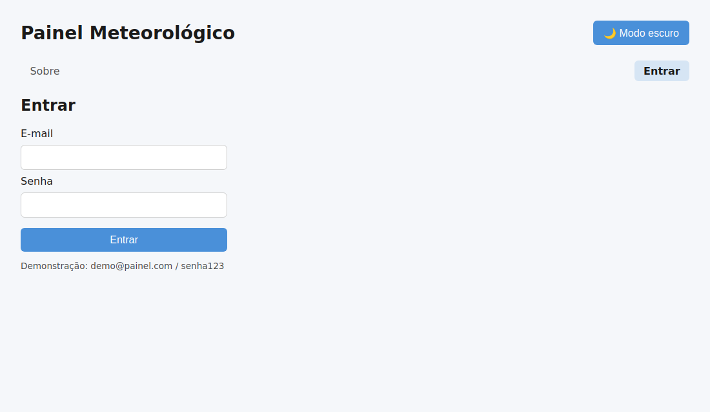
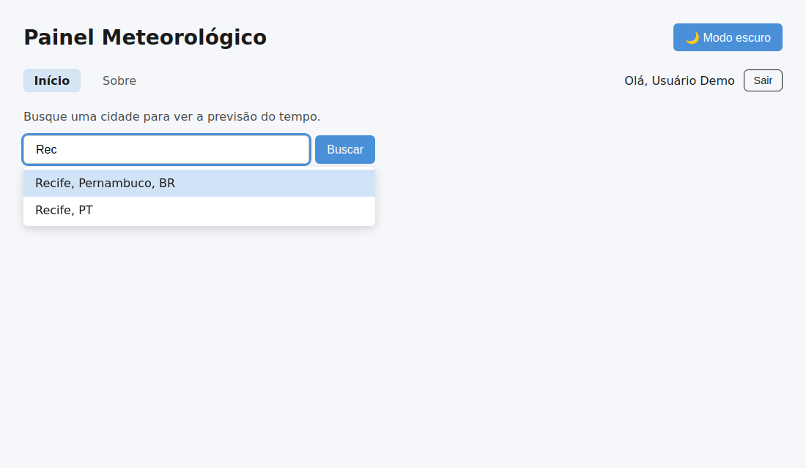
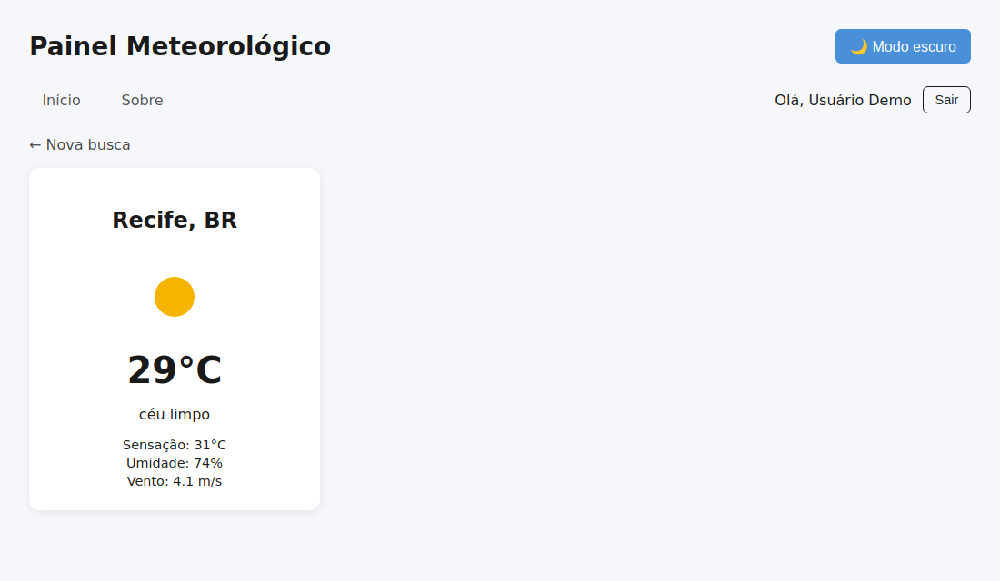
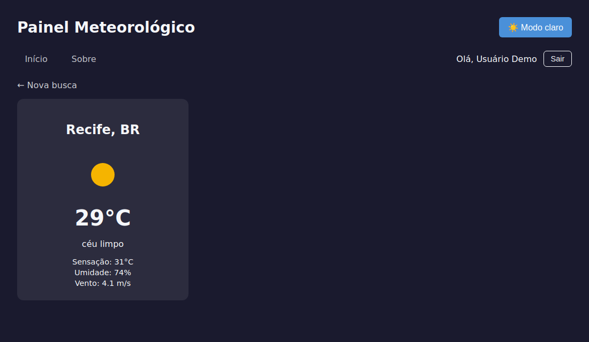
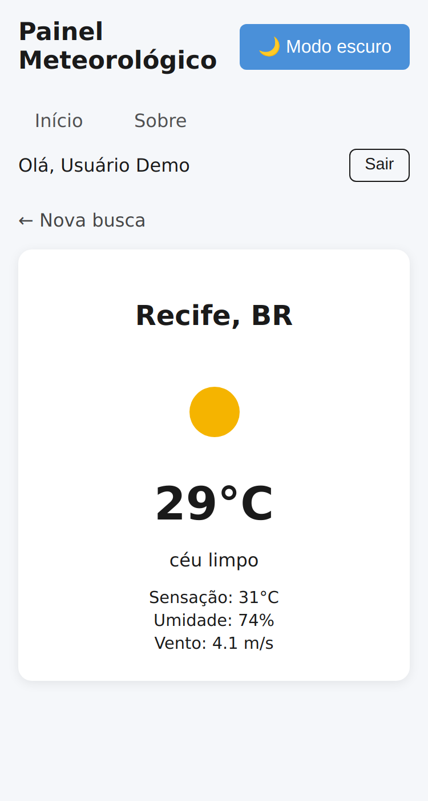

# 🌤️ Painel Meteorológico

> Aplicação web que mostra o clima atual de qualquer cidade do mundo, com login por token (JWT), backend local, testes automatizados e interface responsiva.

> **Deploy Vercel deste monorepo:** publica somente a interface em `/painel`. A API não faz parte do deploy, então login, cadastro e sessão autenticada não estarão disponíveis no site publicado.


**Acesso local de demonstração:** `demo@painel.com` · `senha123` (no deploy da interface, a API não é publicada).

---

## 📸 Capturas de tela

| Login | Busca com sugestões |
| :---: | :---: |
|  |  |

| Previsão (claro) | Previsão (escuro) |
| :---: | :---: |
|  |  |

<p align="center"></p>

> As capturas acima foram geradas com dados de exemplo para ilustrar a interface.

---

## ✨ Funcionalidades

- 🔐 **Autenticação completa por token:** login, sessão restaurada ao recarregar, logout e rotas protegidas.
- 🔎 **Busca com autocompletar:** sugestões de cidades com *debounce*, navegável por mouse **e teclado**.
- 🌡️ **Clima atual:** temperatura, sensação térmica, umidade, vento e ícone, em português.
- 🌙 **Tema claro/escuro:** respeita a preferência do sistema e lembra a escolha do usuário.
- 📱 **Responsivo** e **acessível** (rótulos ARIA, foco visível, `prefers-reduced-motion`).
- ⚡ **Carregamento otimizado:** a página "Sobre" usa *lazy loading* (code splitting).
- 🧪 **59 testes automatizados** no front-end e na API.

## 🧰 Tecnologias

| Camada | Tecnologias |
| --- | --- |
| Front-end | React 19, React Router 7, Context API, Vite |
| Back-end | Node.js, Express 5, JSON Web Token, bcryptjs |
| Testes | Jest, React Testing Library, user-event, Supertest |
| Qualidade | ESLint |
| Deploy | Vercel (interface estática em `/painel`) |
| API externa | [OpenWeatherMap](https://openweathermap.org/api) |

## 🚀 Como rodar localmente

**Pré-requisitos:** [Node.js](https://nodejs.org) 20 ou superior e uma chave gratuita da [API do OpenWeatherMap](https://home.openweathermap.org/api_keys).

```bash
# 1. Clonar e instalar
git clone https://github.com/Jaysantosxx/DeploySemana6.git
cd DeploySemana6
npm install

# 2. Configurar variáveis de ambiente
cp .env.example .env        # Windows (PowerShell): copy .env.example .env
# edite o .env e preencha VITE_OWM_KEY

# 3. Iniciar front-end + API juntos
npm run dev
```

Acesse **http://localhost:5173** e entre com `demo@painel.com` / `senha123`.


### Variáveis de ambiente

| Variável | Onde | Obrigatória | Descrição |
| --- | --- | :---: | --- |
| `VITE_OWM_KEY` | Front-end | Sim | Chave da API do OpenWeatherMap |
| `JWT_SECRET` | Back-end | **Sim, em produção** | Segredo de assinatura dos tokens (ex.: `node -e "console.log(require('crypto').randomBytes(32).toString('hex'))"`) |
| `JWT_EXPIRES_IN` | Back-end | Não | Validade do token (padrão `1h`) |
| `DEMO_EMAIL` / `DEMO_PASSWORD` | Back-end | Não | Credenciais do usuário de demonstração |

### Scripts

| Comando | Descrição |
| --- | --- |
| `npm run dev` | Front-end (Vite) + API (Express) juntos |
| `npm run dev:web` / `npm run dev:server` | Apenas o front-end / apenas a API |
| `npm run build` | Build de produção em `dist/` |
| `npm test` | Executa todos os testes |
| `npm run test:coverage` | Testes com relatório de cobertura |
| `npm run lint` | Análise estática com ESLint |

## 🏗️ Arquitetura

```
.
├── server/               # API REST local: login, /me, health (+ testes)
├── src/
│   ├── components/       # SearchBar, WeatherDisplay, ProtectedRoute, ThemeSwitcher
│   ├── context/          # ThemeContext e AuthProvider (estado global)
│   ├── hooks/            # useFetch, useAuth, useDocumentTitle
│   ├── layouts/          # AppLayout (cabeçalho, navegação, <Outlet />)
│   ├── pages/            # Home, ForecastDetails, Login, About, NotFound
│   ├── services/         # authApi (chamadas HTTP ao backend)
│   └── config.js         # Único ponto de leitura de variáveis de ambiente
└── vercel.json           # Configuração Vercel compartilhada na raiz do monorepo
```

O fluxo de autenticação descrito acima funciona quando a API local está em execução. O deploy estático em `/painel` não inclui esse serviço.

### Fluxo de autenticação

```
Login ──► POST /api/auth/login ──► { token, user }   (JWT, expira em 1h)
            │
            ├─ token guardado no localStorage
            └─ rotas protegidas liberadas

Ao recarregar: GET /api/auth/me  (Authorization: Bearer <token>)
   200 → sessão restaurada   |   401 → token descartado → /login

Logout ──► token e estado apagados
```

**Decisões de segurança:** senhas armazenadas apenas como hash (bcrypt); mensagem de erro idêntica para e-mail inexistente e senha errada; segredo JWT obrigatório em produção; o token é enviado **somente** ao nosso backend, nunca à API do OpenWeatherMap.

## 🧪 Testes

```bash
npm test
```

| Alvo | Tipo | O que cobre |
| --- | --- | --- |
| `WeatherDisplay`, `SearchBar`, `ProtectedRoute`, `ThemeSwitcher` | Componentes | Estados de UI, debounce, teclado e acessibilidade, redirecionamentos, persistência de tema |
| `useFetch`, `useDocumentTitle` | Hooks | Sucesso, erros HTTP/rede, URL nula, troca de URL, cancelamento |
| `auth-flow` | Integração | Login, erro de credenciais, servidor fora do ar, sessão restaurada, token expirado, logout |
| `server/app` | Integração (Supertest) | Login, validação, tokens ausentes/adulterados/expirados |

O `fetch` é simulado em todos os testes: nenhum deles acessa a internet.

## 🙋 Autora

**Jayana Santos** — [@Jaysantosxx](https://github.com/Jaysantosxx)